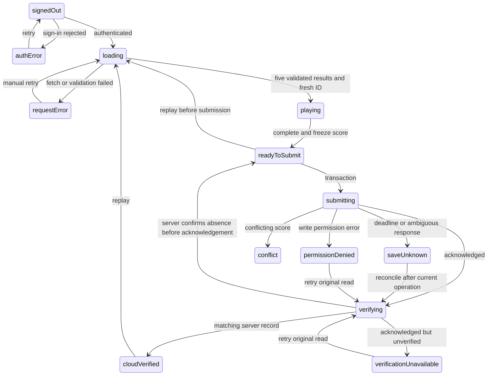

# Science Signal

CSC 4360 In-Class Activity 16, Class B. Android application `edu.csc4360.science_signal`.

## Run and build

Use Flutter 3.47.4, Dart 3.13.3, an Android SDK, and an online Android emulator or device.

```sh
flutter pub get
dart format --output=none --set-exit-if-changed lib test integration_test
flutter analyze
flutter test
flutter build apk --release
adb install -r build/app/outputs/flutter-apk/app-release.apk
```

The release uses Flutter AOT and the Flutter template's local debug signing certificate for classroom installation. FlutterFire generated the Android client configuration for `science-signal-b-rgg-261117`. It contains public Firebase app identifiers and an Android client API key. Test credentials are provided privately or provisioned in Firebase Authentication. For a separate project, configure Email/Password, create a Standard Native Firestore database and run:

```sh
flutterfire configure --project YOUR_PROJECT --platforms android --android-package-name edu.csc4360.science_signal
firebase deploy --only firestore:rules --project YOUR_PROJECT
```

## Verify behavior

- Run the parser and UI suite with `flutter test`. The actual Open Trivia DB response is archived in [evidence/t02.json](evidence/t02.json).
- Run `flutter test integration_test/cloud_test.dart -d DEVICE --reporter expanded` against the dedicated test project. It creates synthetic Firebase users and leaves their evidence attempts intact. Use a test project with deployed rules and Email/Password enabled.
- Launch the release, sign in, complete a round, submit, and observe **Cloud verified**. Force-stop and relaunch the app. Under the same session, choose **Retrieve latest saved round** and compare the round ID and score.
- In a debug build, enable **Deny next post-write verification** before submitting to test an acknowledged write followed by denied verification. Use **Verify original round** after the one-shot injection clears. Check the original document from the server.
- The debug service-failure controls inject one `unavailable` or `resource-exhausted` error. Reconcile on the same document path before resubmitting.
- Compare logs and screenshots in [evidence/](evidence/). Integration traces record only round-ID suffixes.

## State and storage



A quiz generates the Firestore ID without creating a document. The final score is written once at `users/{uid}/attempts/{roundId}`. Firestore may rerun the transaction callback. The UI leaves the underlying SDK operation in flight after its 10-second UI deadline and prevents overlapping attempts. Acknowledged writes can only trigger another server read. A server match includes all fixed fields, the resolved timestamp, the exact ID and clean metadata. The owner path enforces isolation. Client-computed scores can still be dishonest within the accepted range.

Trivia by [Open Trivia DB](https://opentdb.com/api_config.php), [CC BY-SA 4.0](https://creativecommons.org/licenses/by-sa/4.0/).

